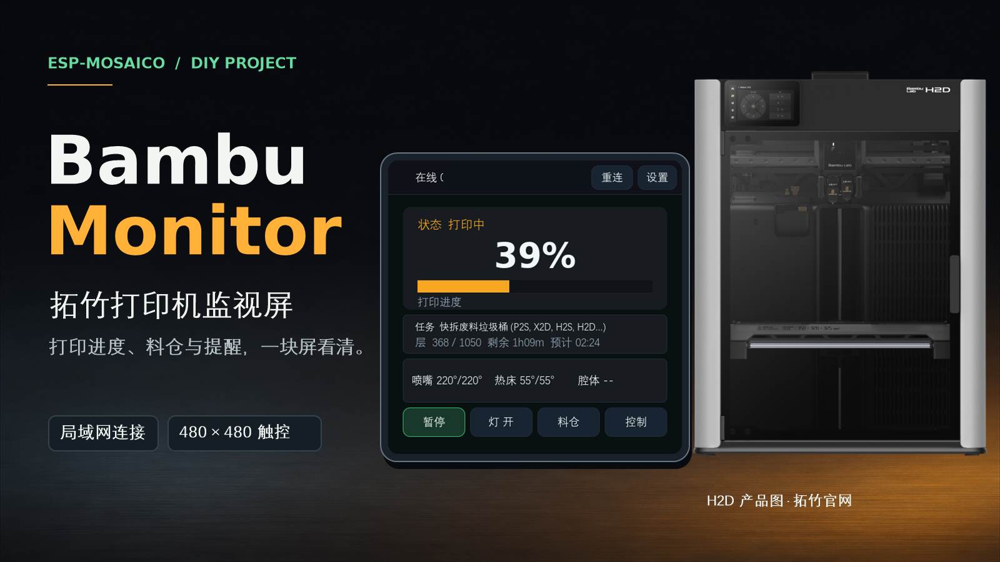
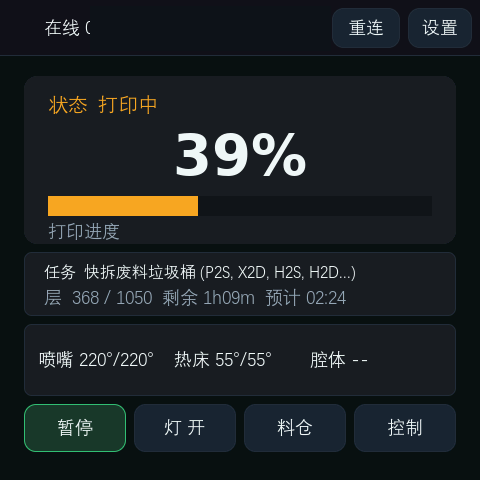
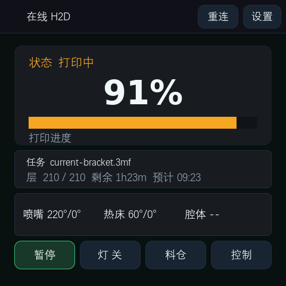
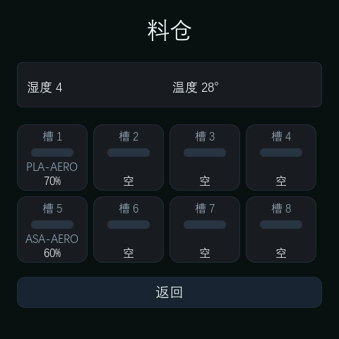
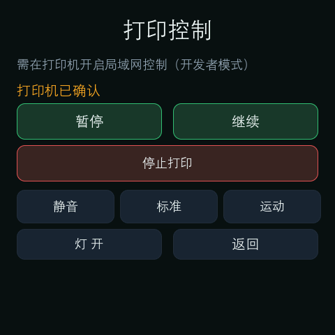

# Bambu Monitor for ESP-Mosaico · 拓竹打印机监视屏

[](https://github.com/esp-mosaico)
[](https://components.espressif.com)
[](LICENSE)

把 [ESP-Mosaico](https://github.com/esp-mosaico) 的 480×480 圆角触摸屏变成拓竹（Bambu Lab）打印机的局域网监视屏：**进度、层数、温度、剩余时间一眼看完，完成和出错自动提醒，还能直接控制**。通过打印机的局域网 MQTT 接口直连，全程不依赖云端。

> 已在拓竹 **H2D + AMS Pro** 上实测；其他型号未验证。



<details>
<summary>📱 真机打印画面（点开）</summary>



</details>

## 功能

- **状态一览**：任务名、百分比大字与进度条、层数、喷嘴/热床目标与实时温度、剩余时间倒计时与「预计 HH:MM」完成时刻（SNTP 校时）。
- **AMS 料仓**：双单元 8 槽的颜色色块、材质名（含 PLA-AERO / ASA-AERO 等长名称）、余量百分比、湿度与温度。
- **提醒不漏**：打印完成 / 出错全屏弹窗 + 蜂鸣，出错带完整 32 位错误码；重连或换任务后旧提醒自动作废，不会误确认新会话的提醒。
- **打印中快捷控制**：暂停/继续、腔室灯开关、料仓、控制页；控制页支持三档打印速度、双灯控制和**带二次确认的停止**（确认绑定当前设备/任务/会话，任务切换后确认自动作废，不会误停新任务）。
- **健壮连接**：局域网 MQTT 直连（TLS 加密传输）；断线后 5 秒 → 300 秒指数退避自动重建；连接 / 订阅 / 遥测分别有截止时间；每 60 秒输出一条连接统计日志。
- **工程可靠性**：有界 JSON 解析（64 KiB / 32 层，畸形报文不崩溃）、MQTT 分片重组、命令 8 秒超时与逐条 ACK 匹配、长任务名哈希识别。

| 状态页 | 料仓 | 控制页 |
| --- | --- | --- |
|  |  |  |

模拟器与真机使用同一套 C 界面代码与烘焙资源。

## 快速开始

> 📖 **完整图文教程**（打印机准备 → 首次配对 → 日常使用 → 连不上怎么办）：**[docs/USAGE.md](docs/USAGE.md)** —— 10 分钟三步上手。

### 方式一：社区固件（推荐）

从 [Mosaico Ideas 项目页]（上传后补链接）或本仓库 [Releases] 下载 `bambu_monitor-v0.2-system-update.irisfw`，通过 ESP-Iris 的 System Update 安装。首次启动后：

1. 屏幕右下 **设置** → 输入打印机的**局域网 IP**；
2. 再输入**访问码**（打印机屏幕：设置 → 网络 → 局域网/访问码，需开启开发者模式/局域网服务）；
3. 保存后自动连接，左上角显示「在线」。

### 方式二：源码构建

本项目是 [ESP-Mosaico workspace](https://github.com/esp-mosaico) 的应用，需在工作区内构建：

```sh
# 在 ESP-Mosaico workspace 根目录
python mosaico.py project sim --project projects/bambu_monitor        # 模拟器预览
python mosaico.py iris system-update --project projects/bambu_monitor # 安装到设备
```

依赖：ESP-IDF（`7b9cc1ac79f865983f59bb8ff3ff43eb74ff1dbe`）、esp-mosaico-bsp、esp-mosaico-utils（含 ESP-Iris / Recovery）、ESP-GSP 1.5.1、GSPC 0.7.0。详见 workspace 文档。

### 回归测试

```sh
python pc/tests/run_native_tests.py --cc gcc --output <new-dir>      # 75 组原生回归
python pc/tests/test_ui_integration.py --project <build-copy> --sim <official-sim> --output <new-dir>  # 106 项界面交互
python pc/tests/run_ui_startup_tests.py                              # 29 组 UI 故障注入
```

## 工作原理

```
┌ 拓竹打印机 (H2D) ┐         ┌ ESP-Mosaico ───────────────┐
│  MQTT broker     │◄──TLS──►│ bmb_mqtt  生命周期/重连/发送 │
│  :8883 (bblp)    │  局域网  │ bmb_rx    64KiB 分片重组     │
└──────────────────┘         │ bmb_json  有界 JSON 校验     │
                             │ bmb_report 增量应用/ACK/提醒 │
                             │ bmb_command 命令状态机/STOP  │
                             │ bmb_ui    GSP 渲染/触摸      │
                             └────────────────────────────┘
```

模块职责与数据流向见 [docs/community-submission.md](docs/community-submission.md) 与开发记录。

## 已知限制

- 需要打印机开启**开发者模式 / 局域网服务**并提供访问码；「仅局域网模式」开关每次切换都会重置访问码，需要重新配对。
- 局域网 TLS 加密传输，但当前跳过打印机自签名证书校验（无法离线预置其证书）。
- 命令发送等待下一份完整状态报文（实测 H2D 约 1.3 秒）；无报文时 8 秒超时。
- H2D 状态报文暂不包含腔体温度，界面显示「--」。
- 打印中的真实暂停/停止请先在自己的打印机上确认行为再依赖；本项目不对损坏的打印任务负责。

## 致谢

- [ESP-Mosaico](https://github.com/esp-mosaico) — ESP32-S31 480×480 retained-Recovery 平台
- [Espressif ESP-GSP](https://components.espressif.com) — 图形场景运行时
- 拓竹 LAN 协议参考了社区对 Bambu MQTT 接口的公开研究

## License

[MIT](LICENSE)
